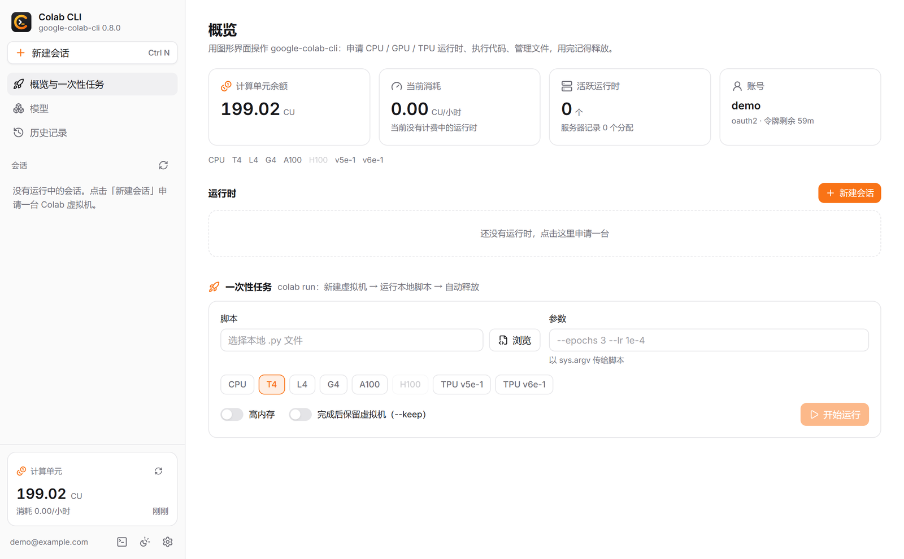

<p align="center">
  
</p>

<h1 align="center">Colab CLI UI</h1>

<p align="center">
  <a href="https://github.com/googlecolab/google-colab-cli">google-colab-cli</a> 的桌面客户端：申请 CPU / GPU / TPU 运行时、执行代码、管理文件、从 HuggingFace 选模型、一键部署大模型 API、端口转发、多账号切换，用完一键释放。
</p>

<p align="center">
  <a href="#安装与首次使用">下载与安装</a> |
  <a href="#功能">功能</a> |
  <a href="#数据与凭据">数据与凭据</a> |
  <a href="#开发">开发</a>
</p>

<p align="center">
  <a href="https://github.com/codeyu/colab-cli-ui/releases"></a>
  <a href="https://github.com/codeyu/colab-cli-ui/actions/workflows/release.yml"></a>
  <a href="https://github.com/egoist/mygo"></a>
  <a href="LICENSE"></a>
</p>

<p align="center">
  <a href="https://github.com/codeyu/colab-cli-ui/releases/latest"></a>
  <a href="https://github.com/codeyu/colab-cli-ui/releases/latest"></a>
  <a href="https://github.com/codeyu/colab-cli-ui/releases/latest"></a>
</p>

<p align="center">
  
</p>

> 非 Google 官方软件。基于 [MyGo](https://github.com/egoist/mygo)（Go + 系统 WebView）构建，界面风格参考 t3code，功能组织参考 EasyColab。目前只在 Windows 11 上实测过；google-colab-cli 官方只支持 Linux 和 macOS，但在 Windows 上实测可用。

## 安装与首次使用

1. 在 [Releases](https://github.com/codeyu/colab-cli-ui/releases/latest) 下载对应系统的安装包：Windows 选 `-setup-…-amd64.exe`（ARM 设备选 `-arm64.exe`），macOS 选 `.dmg`，Linux 选 `.deb` / `.rpm`，或 `.tar.gz` 配合 `install.sh`。安装包没有代码签名，首次打开的系统提示怎么处理，见 Release 说明。
2. 第一次打开会显示三步引导，已完成的步骤会自动跳过：
   1. **安装 uv**：给出官方安装命令，复制到终端运行，再点「重新检测」。
   2. **安装 Colab CLI**：点「安装」，软件执行 `uv tool install google-colab-cli`。
   3. **登录 Google**：点「登录 Google」，在浏览器里同意授权，把页面上的授权码粘贴回软件。也可以改用 gcloud 的 ADC。
3. 进入主界面后，点「新建会话」申请虚拟机。**GPU / TPU 按小时消耗计算单元，用完记得「释放」。**

## 功能

| 界面 | 对应的 CLI 命令 |
| --- | --- |
| 新建会话：CPU / T4 / L4 / G4 / A100 / H100 / TPU v5e-1 / v6e-1，可选高内存；显示每小时大约消耗多少 CU；账号无资格的加速器会变灰；不允许重名；取消或失败后自动释放可能已分配的虚拟机 | `colab new -s NAME --gpu/--tpu --high-mem` |
| 启动脚本：从历史记录里挑选步骤保存，新建会话时选择，开机后自动执行（需要时先挂载 Drive） | `colab exec` |
| 多账号：添加多个 Google 账号，一键切换，同时查看各账号的余额和运行中的虚拟机；对会话的操作自动使用它所属的账号 | 每个账号独立的凭据和 `--config` 状态文件 |
| 托盘图标：显示运行中的虚拟机、已运行时长和大约花费；有虚拟机在计费时关窗口会留在托盘 | — |
| 每个会话已运行多久、大约花了多少 CU，概览页显示合计 | 读取 CLI 历史里的 `session_created` 时间 |
| 任务完成通知：运行超过 1 分钟的代码、安装、下载、部署在后台结束时弹出系统通知 | — |
| 侧栏会话列表，状态自动刷新；服务器上未在本机登记的运行时（例如网页里打开的）也会列出，并可一键释放 | `colab status`、`colab sessions` |
| 费用保护：VM 上的看门狗按时长或空闲自动释放（关掉本软件也有效）；余额低于下限时释放全部会话 | `colab exec`（看门狗通过 `$TBE_RUNTIME_ADDR/unassign` 释放） |
| 计算单元余额、每小时消耗、可用的加速器 | `colab usage`（读取服务器 ccu-info 的完整回复） |
| 控制台：Python / Shell 流式输出、ANSI 颜色、matplotlib 图片内联显示；代码报错会如实标为失败；「停止」会中断内核里的代码 | `colab exec -s NAME`（Shell 模式用 `%%bash`）；中断走 Jupyter API |
| 运行本地 `.py` / `.ipynb` | `colab exec -s NAME -f FILE` |
| 模型：搜索 HuggingFace，勾选文件（默认只选 PyTorch 权重；GGUF 默认 Q4_K_M），在 VM 后台下载（连接断开也不影响），插入加载代码 | `colab exec`（huggingface_hub） |
| 模型 API：在 VM 上用 Ollama 一键部署模型（Ollama 模型库、HuggingFace GGUF，或 VM / Drive 上的 `.gguf` 文件），得到 OpenAI 兼容 API 并转发到本机，可直接测试对话 | `colab exec`（安装 Ollama、拉取并加载模型） |
| 端口转发：把 VM 上的端口（Gradio、ComfyUI、Ollama 等）转发到本机 `127.0.0.1`；会话释放后自动停止，不会重新开机 | 经运行时的 `/colab/ssh` WebSocket 直接建立 SSH 隧道，不使用 `colab ssh --proxy-mode` |
| 文件浏览器：浏览、上传（支持拖拽）、下载、删除 | `colab ls / upload / download / rm` |
| 包管理：安装包或 requirements.txt | `colab install` |
| 资源监控：CPU、内存、磁盘、GPU 显存 / 利用率 / 温度 / 功耗曲线 | `colab exec`（psutil + nvidia-smi 采样） |
| 历史记录：浏览、导出（ipynb / md / txt / jsonl）、单条重新执行 | 读取 `~/.config/colab-cli/history`，`colab log -o` |
| 在 Colab 网页中打开会话 | `colab url` |
| REPL / SSH / 挂载 Drive / VM 端 GCP 授权（在新终端窗口中打开） | `colab repl / ssh / drivemount / auth` |
| 重启内核、释放会话、全部释放 | `colab restart-kernel`、`colab stop [--all]` |
| 一次性任务：新建 VM → 运行脚本 → 自动释放 | `colab run` |
| CLI 命令日志（Ctrl+\`）：界面执行过的每条命令及其输出 | — |
| 设置：colab 路径、`--auth oauth2/adc`、`--config`、`-c`、优先使用 IPv4、费用保护默认值、HuggingFace token 与搜索地址、启动脚本管理 | 全局参数 |

## 数据与凭据

- **Google 登录令牌**由 CLI 自己保存在系统凭据管理器（Windows 凭据管理器）中，本软件不读取。默认账号用 CLI 原来的那条记录；在软件里添加的账号各有一条（服务名为 `google-colab-cli@<账号 ID>`），会话状态文件在 `%APPDATA%\Colab CLI UI\accounts\<账号 ID>\`。终端里直接运行的 `colab` 始终使用默认账号。
- **端口转发用的 SSH 密钥**由本软件生成，保存在 `%APPDATA%\Colab CLI UI\ssh\`，不使用你的 `~/.ssh`。
- **HuggingFace token** 保存在系统凭据管理器中。下载需授权的模型时，它以文件形式经 `colab upload` 传给 VM，不会出现在会话历史里（`colab exec` 执行的代码会被写进历史）。
- **设置、启动脚本和账号列表**保存在 `%APPDATA%\Colab CLI UI\` 下（`settings.json`、`startup-scripts.json`、`accounts.json`）。
- 界面里的 CLI 命令日志会隐藏含凭据的调试行；CLI 自己的 `~/.config/colab-cli/colab.log` 也会把令牌替换成 `REDACTED`。

## 开发

需要 Go 1.27+、Bun，以及已安装的 `colab`。

```sh
bun install
bun run dev        # 实时重载开发
bun run build      # 打包到 build/windows-amd64/（exe + 安装程序）
go test ./...      # 后端测试：输出解析、流式输出、脚本生成、凭据隐藏
COLAB_UI_LOGIN_TEST=1 go test -run TestLoginFlowSignedOut ./...
                   # 用真实 CLI 测登录流程：临时主目录 + 空凭据存储，不读也不改你的登录
```

改了 `resources/icon.svg` 后重新生成 PNG（需要带 librsvg 的 ImageMagick）：

```sh
magick -background none RSVG:resources/icon.svg -resize 1024x1024 -depth 8 PNG32:resources/icon.png
```

## 结构

- `main.go`：应用与窗口
- `colab.go`：绑定给前端的 `Colab` 服务（会话、执行、文件、监控、历史）
- `onboarding.go`：首次使用引导（检测 uv、安装 CLI、在软件内登录）
- `hf.go`：HuggingFace 搜索、模型信息、下载到 VM、token
- `accounts.go`：多账号（每个账号独立的凭据记录和会话状态文件）
- `tunnel.go`：端口转发（WebSocket 上的 SSH 隧道）
- `llmapi.go`：用 Ollama 部署模型 API
- `tray.go`：托盘图标与系统通知
- `scripts.go`：启动脚本的存储
- `runner.go`：调用子进程、流式回传输出、识别 `[Image saved to: …]` 图片、隐藏凭据
- `settings.go`：偏好设置
- `proc_*.go`：隐藏子进程控制台窗口、在新终端中运行交互式命令
- `resources/icon.svg`：图标源文件（`icon.png` 由它生成）
- `src/`：React + Tailwind 前端；`src/mygo.ts` 由 `mygo generate` 从 Go 代码生成
